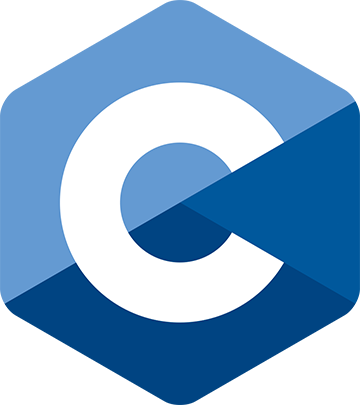
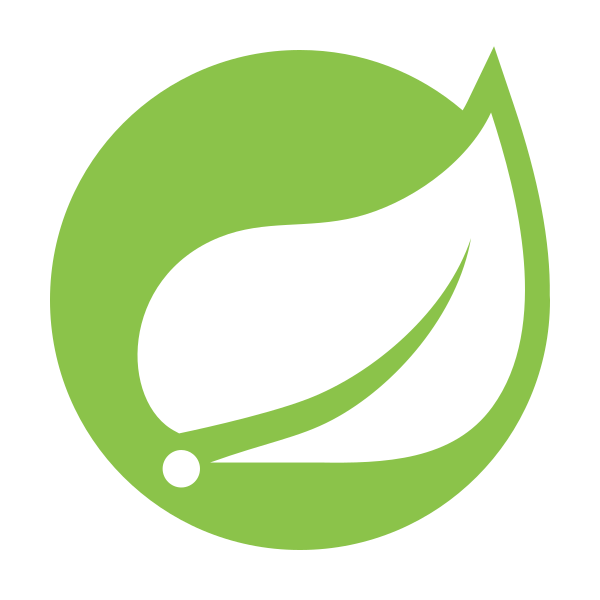

# 🙌 ¡Hola, soy Ignacio! 🙌

Estudiante de **Analista Programador** en **Duoc UC**

## 👨‍💻 Sobre mí

- 🔌Mis lenguajes preferidos son Java y C
- 🎶Me gusta la música y hacer proyectos
- ⚙️Me gusta la automatización, el desarrollo Backend y el hardware

## 🔌 Lenguajes y Herramientas

  
  
  
  
  
  
  
  
  

## 📊 GitHub Stats

  

